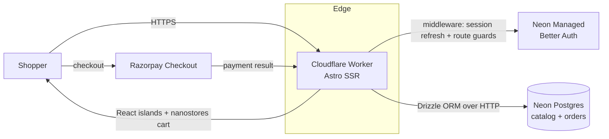

# janaushadhi-astro

> Jan Aushadhi generic-medicine e-commerce storefront — Astro SSR on Cloudflare Workers.

[](./LICENSE)
[](https://github.com/chirag127/janaushadhi-ecommerce-astro/stargazers)
[](https://github.com/chirag127/janaushadhi-ecommerce-astro/commits/main)
[](https://github.com/chirag127/janaushadhi-ecommerce-astro/actions/workflows/test.yml)
[](https://astro.build)

## What it is / why it exists

A full storefront for selling generic medicines under the Pradhan Mantri Bhartiya Janaushadhi Pariyojana (PMBJP), catalog of ~2,439 medicines across 62 categories. It's built to run for near-zero cost on the edge: Astro renders server-side, `@astrojs/cloudflare` compiles the app to a Cloudflare Worker, and Neon Postgres (serverless) holds the catalog and commerce data. This is one of four framework variants (astro / nextjs / laravel / wordpress) that share the same Neon Postgres project, so the same shop can be compared head-to-head across stacks.

**Live:** https://janaushadhi-astro.oriz.in · **Repo:** https://github.com/chirag127/janaushadhi-ecommerce-astro

⭐ If this is useful, please star the repo — it helps others find it.

## Architecture



## Features

- **Storefront:** landing, product catalog (search, category filter, price range, sort, pagination), product detail (reviews, related, JSON-LD), categories, cart, checkout (address + coupon codes + Razorpay / COD), order confirmation + history, wishlist, blog, contact, FAQ, dark/light/system theme.
- **Account:** dashboard, orders, address book (CRUD, default address), wishlist, reviews.
- **Admin (`role = admin`):** dashboard (revenue / orders / products / customers), products CRUD + image upload, categories, coupons, orders + status update, inventory.
- **Platform:** cookie sessions with middleware refresh + route guards (`/account`, `/orders`, `/checkout`, `/admin`), Neon Managed Better Auth (SSO), en/hi i18n sitemap, prefetch-on-viewport.

## Tech stack

| Layer | Choice |
|---|---|
| Framework | Astro 7 SSR (`output: "server"`) |
| Adapter | `@astrojs/cloudflare` → Cloudflare Workers |
| Database | Neon Postgres (`@neondatabase/serverless`) + Drizzle ORM |
| Auth | Neon Managed Better Auth (`@neondatabase/auth`) |
| Payments | Razorpay (test mode), direct key integration |
| UI | React 19 islands, Tailwind CSS v4, nanostores (persistent cart) |
| Tooling | TypeScript 5, Vitest, Playwright, pnpm |

## Repository structure

```
janaushadhi-astro/
├── astro.config.mjs        # Astro + Cloudflare adapter, sitemap, i18n
├── wrangler.jsonc          # Cloudflare Worker config
├── src/
│   ├── pages/              # routes (storefront, account, admin, api)
│   ├── components/         # Astro + React island components
│   ├── layouts/            # shared layouts
│   ├── lib/                # db (Drizzle), auth, helpers
│   ├── middleware.ts       # session refresh + route guards
│   └── styles/             # Tailwind v4 styles
├── db/ · migrations/ · neon-migration/   # schema + migrations
├── db-seed/ · meds.csv · scripts/        # catalog seed (2,439 meds)
└── .github/workflows/      # test.yml, deploy.yml, megalinter.yml
```

## Quick start

```bash
pnpm install
cp .env.example .env    # fill in values — see Configuration below
pnpm dev                # http://localhost:4321
pnpm build              # production build (Cloudflare Worker output)
pnpm preview            # preview the built worker locally
pnpm test               # Vitest
```

## Deployment

GitHub Actions deploys on every push to `main` (`.github/workflows/deploy.yml`): install deps → write build-time `PUBLIC_*` env → `pnpm build` (Astro + `@astrojs/cloudflare` Worker bundle) → `wrangler deploy` → runtime secrets pushed via `wrangler secret put`. Required GitHub secrets include `CLOUDFLARE_API_TOKEN`, `CLOUDFLARE_ACCOUNT_ID`, and the runtime env vars below.

## Configuration

Copy `.env.example` to `.env`. Names and purpose only — never commit real values.

| Variable | Purpose |
|---|---|
| `SITE_URL` | Public base URL of the site |
| `PUBLIC_APP_URL` | Same as `SITE_URL`; exposed to client-side code |
| `DATABASE_URL` | Neon Postgres connection string |
| `PUBLIC_RAZORPAY_KEY_ID` | Razorpay Key ID — public, safe for browser |
| `RAZORPAY_KEY_SECRET` | Razorpay Key Secret — server-only |
| `PUBLIC_RAZORPAY_TEST_MODE` | `"true"` = test environment; `"false"` = live |
| `NEON_AUTH_BASE_URL` | Server-side Better Auth base URL |
| `PUBLIC_NEON_AUTH_BASE_URL` | Same URL, `PUBLIC_`-prefixed for client components |
| `NEON_AUTH_COOKIE_SECRET` | Secret (min 32 chars) for signing session cookies |

## Part of the oriz family

This is one of ~80 sites in the **oriz** family. More at [blog.oriz.in](https://blog.oriz.in).

**Cost:** runs at ~$0 on the Cloudflare free tier (Workers + edge SSR) with a Neon free-tier Postgres.

## Contributing

Issues and PRs welcome. Keep changes focused; run `pnpm test` and `pnpm check` before opening a PR.

## Security

No secrets in the repo — `.env*` is gitignored, a sops+age vault holds real values, and only `PUBLIC_*` vars reach the browser.

## License

MIT © 2026 Chirag Singhal — see [LICENSE](./LICENSE).

## Author

Chirag Singhal · chirag@oriz.in

## Status

Stable / actively maintained. Conventional commits are the changelog.
